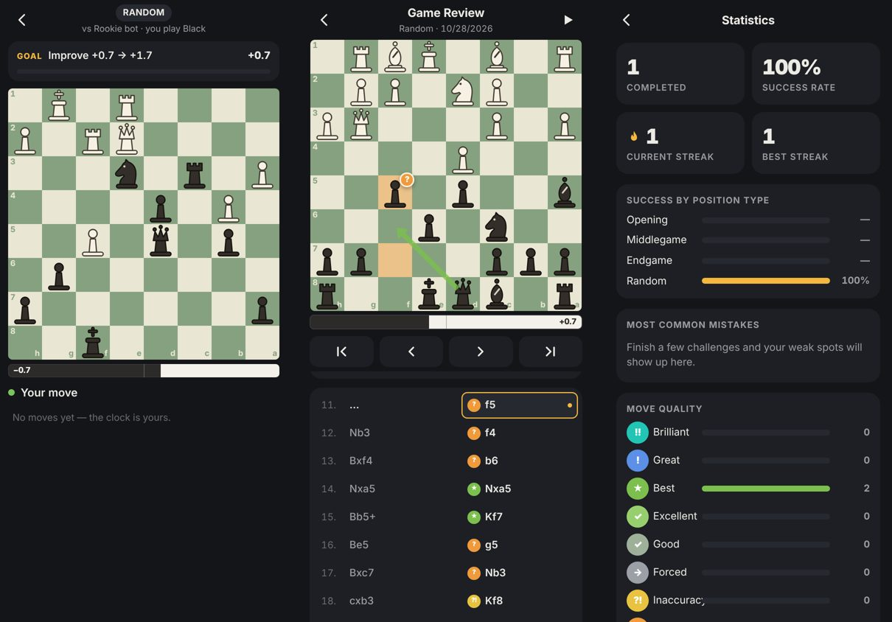

# ♞ Chess Position Trainer

Play a chess bot from **random, legal positions** (openings, middlegames, endgames) and get a **Chess.com-style review** of every game. It works on **iPhone** (as a home-screen app) and on **PC/Mac** (as an installable desktop app), and it runs **offline** after the first load.



## Features

- **Random legal positions.** There are 3,400+ positions taken from real Stockfish games and checked for legality and balance. You can filter by Opening, Middlegame, Endgame or Random.
- **No skipping.** To clear a challenge you have to improve the engine eval by +1.0, deliver checkmate, or get checkmated. If you close the app mid-game, the same challenge picks up where you left off.
- **Play online.** Quick **matchmaking** pairs you with a player near your rating. **Play a friend** lets you create a lobby, share the 6-letter code or invite link, and your friend joins. Games are live, with clocks (3|2, 5, 10, 15|10), draw offers, resign, rematch, disconnect handling and Elo ratings. Every online game starts from a random, balanced position, just like training.
- **Accounts.** Sign in with email and password or Google, or play as a guest (and upgrade later). You can change your display name or delete your account at any time. There's a [Privacy Policy](privacy.html) and [Terms & Conditions](terms.html). Online play needs a free Firebase project; see [SETUP-ONLINE.md](SETUP-ONLINE.md).
- **Stockfish 18 bot** with 6 strength levels (Rookie ≈800 up to Master 2500+), running entirely on your device.
- **Eval bar** under the board that updates after every move.
- **Full chess rules.** Castling, en passant, promotion (with a piece picker), check, stalemate, repetition and the 50-move rule are all handled.
- **Touch & mouse controls.** Tap-tap or drag-and-drop to move (on touch screens the piece lifts above your finger), with legal-move dots, last-move highlight and check glow.
- **Draw arrows (PC).** Right-click and drag to draw arrows (knight moves get L-shaped arrows); right-click a square to circle it. Hold Shift, Ctrl or Alt for red, green or blue. Left-click clears them.
- **Move animations.** Pieces slide (castling moves the rook too), captured pieces fade out, promotions pop, and dropped pieces settle. Speed: Fast, Normal or Slow.
- **Game review.** Every move gets a label: Brilliant, Great, Best, Excellent, Good, Forced, Inaccuracy, Mistake, Miss or Blunder. Each label comes with a plain-language explanation that covers hanging pieces, missed mates, allowed mates, forks, pins, skewers, discovered attacks and material lost.
- Tap any move to jump to it. The review shows the best-move arrow, compares "you played" with "best move", lets you play out the engine line, and includes an eval graph and the key turning points.
- **Stats.** Completed challenges, success rate, current and best streak, success by position type, your most common mistakes, move-quality breakdown, and the full history of past games (each one can be reopened for review).
- **Customisation.**
  - Dark, Light, Midnight and OLED themes.
  - 9 board themes (Classic Blue, Sage, Walnut, Ocean, Dusk, Graphite, Coral, Marble, Green Marble). The marble boards have real-looking veins running across the whole board. The whole app's accent colour follows the board you pick.
  - 20 piece sets: Classic, Modern, Flat, Wood, Marble, Gold & Silver, Neon, Glass, Ruby, Ink, Sketch, Pixel, Minimal, Letters, Tokens, Shaded 3D, Candy, Ice & Fire, Comic, Jade & Onyx.
  - **A custom background photo** picked from your Photos or files, with dim and blur controls.
  - 15 sound packs, all synthesized live (no audio files): Wood, Soft, Marble, Glass, 8-Bit, Arcade, Piano, Marimba, Bubbles, Keyboard, Sci-Fi, Drums, Zen, Typewriter, Kalimba. Tap one to preview it; there's also a volume slider.
  - Toggles for sound, animations, legal-move dots, coordinates and the eval bar.
  - Everything is saved on the device.

## Put it online (free, with GitHub Pages)

1. Create a **new public repository** on GitHub, for example `chess-position-trainer`.
2. Upload **everything in this folder** (the files and subfolders, not the folder itself), then commit.
3. Go to the repo's **Settings → Pages**. Under *Build and deployment*, choose **Deploy from a branch**, then **main** and **/ (root)**, and click **Save**.
4. After a minute or two the app will be live at
   `https://YOUR-USERNAME.github.io/chess-position-trainer/`

## Install it

**iPhone:** open the link in **Safari**, tap **Share**, then **Add to Home Screen**. It opens full-screen like a normal app and works offline.

**PC / Mac:** open the link in **Chrome** or **Edge** and click the **Install** icon in the address bar (or use the *Install* button on the home screen). It gets its own window plus a Start-menu/Dock shortcut.

## Run locally

Any static web server works, for example:

```bash
python3 -m http.server 8000
# then open http://localhost:8000
```

(Opening `index.html` directly as a file won't work, because browsers block the engine worker on `file://`.)

## Project layout

```
index.html               app shell (screens: home, play, review, stats, settings)
css/app.css              design system, themes, board styles
js/app.js                app controller: challenge flow, review UI, stats, settings
js/board.js              touch/drag chessboard with highlights, arrows, badges, animation
js/engine.js             Stockfish WASM wrapper (UCI over a Web Worker)
js/review.js             full-game analysis, move classification, explanations
js/positions.js          legal position pool + picker
js/background.js         custom background photo (IndexedDB)
js/store.js, sound.js    persistence, synthesized sound effects
js/vendor/chess.js       chess rules (chess.js, BSD-2)
engine/                  Stockfish 18 lite (WASM, GPLv3)
data/positions.json      pre-generated positions with Stockfish evals
sw.js, manifest.webmanifest, icons/   offline + installable app
docs/SPEC.md             original product spec
```

When you update the app, bump `VERSION` in `sw.js` so installed copies download the new files.

## License

GPL-3.0, because the app bundles Stockfish (see `LICENSE`). chess.js is BSD-2-Clause.
